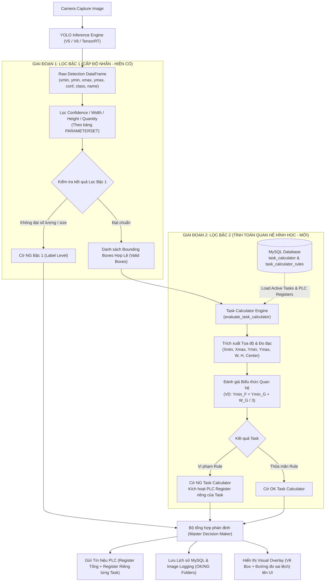
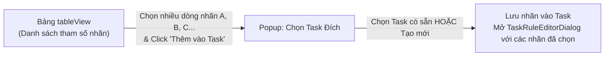

# KẾ HOẠCH & BẢN THIẾT KẾ KIẾN TRÚC: CHỨC NĂNG TASK CALCULATOR (VISION GEOMETRIC INSPECTION)

> **Mục tiêu:** Phát triển module **Task Calculator Workspace** cho từng Camera, cho phép người dùng cấu hình các bài toán kiểm tra ngoại quan nâng cao dựa trên quan hệ hình học, tọa độ tương đối ($X_{\min}, X_{\max}, Y_{\min}, Y_{\max}$), kích thước ($W, H$) và khoảng cách giữa các nhãn AI phát hiện được thông qua giao diện Low-Code / Visual Bounding Box trực quan.

---

## 1. Tổng quan & Luồng Dữ Liệu Toàn Hệ Thống

*(Đã cập nhật theo góp ý: Thực hiện lọc Confidence, Width, Height, Số lượng nhãn trước rồi mới đưa các box đạt chuẩn sang tính toán hình học)*



---

## 2. Chi Tiết Từng Bước Triển Khai (Đã kết hợp góp ý của người dùng)

---

### 🟢 BƯỚC 1: Chuẩn hóa Cơ sở Dữ liệu (Database Schema)

#### Góp ý người dùng đã cập nhật:
> *"Bắt buộc phải có trường PLC Register riêng cho từng task, nếu NG thì gửi biến đó, còn không thì thôi."*

#### Thiết kế bảng chuẩn:
```sql
-- 1. Bảng lưu danh sách Task của từng Camera
CREATE TABLE IF NOT EXISTS task_calculator (
    id                  INT AUTO_INCREMENT PRIMARY KEY,
    camera_id           INT NOT NULL,
    task_name           VARCHAR(255) NOT NULL,
    task_type           VARCHAR(50) NOT NULL DEFAULT 'RELATION_COORDINATE', 
                        -- Các loại: RELATION_COORDINATE, DISTANCE, CUSTOM_EXPRESSION
    logic_mode          VARCHAR(20) NOT NULL DEFAULT 'ALL_PASS', 
                        -- ALL_PASS (tất cả rule đúng thì OK), ANY_PASS
    action_on_fail      VARCHAR(20) NOT NULL DEFAULT 'NG',
    enabled             TINYINT(1) NOT NULL DEFAULT 1,
    
    -- Cấu hình PLC Register riêng cho từng Task khi xảy ra lỗi NG:
    assign_register     VARCHAR(255) DEFAULT '',       -- Địa chỉ thanh ghi PLC (VD: D100, M20...)
    value_bit_on        INT DEFAULT 1,                 -- Giá trị ghi khi Task bị NG
    value_bit_off       INT DEFAULT 0,                 -- Giá trị xóa/reset
    
    created_at          DATETIME NOT NULL DEFAULT CURRENT_TIMESTAMP,
    updated_at          DATETIME NOT NULL DEFAULT CURRENT_TIMESTAMP ON UPDATE CURRENT_TIMESTAMP,
    FOREIGN KEY (camera_id) REFERENCES NUMS_CAMERA(id) ON DELETE CASCADE
) ENGINE=InnoDB DEFAULT CHARSET=utf8mb4;

-- 2. Bảng lưu chi tiết các Rule trong từng Task
CREATE TABLE IF NOT EXISTS task_calculator_rules (
    id                      INT AUTO_INCREMENT PRIMARY KEY,
    task_id                 INT NOT NULL,
    rule_name               VARCHAR(255),
    
    -- Đối tượng 1 (Target Label A)
    label_1                 VARCHAR(255) NOT NULL,
    param_1                 VARCHAR(50) NOT NULL, 
                            -- X_MIN, X_MAX, Y_MIN, Y_MAX, WIDTH, HEIGHT, CENTER_X, CENTER_Y
    instance_select_1       VARCHAR(50) NOT NULL DEFAULT 'BEST_CONF', 
                            -- BEST_CONF, LEFTMOST, RIGHTMOST, TOPMOST, BOTTOMMOST
    
    -- Phép toán so sánh
    operator                VARCHAR(20) NOT NULL, 
                            -- '<', '<=', '>', '>=', '==', '!=', 'BETWEEN'
    
    -- Đối tượng 2 (Reference: Nhãn B hoặc Hằng số)
    target_type             VARCHAR(50) NOT NULL DEFAULT 'LABEL', 
                            -- 'LABEL' hoặc 'CONSTANT'
    label_2                 VARCHAR(255),
    param_2                 VARCHAR(50), 
                            -- X_MIN, X_MAX, Y_MIN, Y_MAX, WIDTH, HEIGHT, CENTER_X, CENTER_Y
    instance_select_2       VARCHAR(50) NOT NULL DEFAULT 'BEST_CONF',
    
    -- Toán tử bù trừ / Tỷ lệ mở rộng (VD: + Width(G) / 3 hoặc + 15.5 pixel)
    math_op                 VARCHAR(10) DEFAULT 'NONE', 
                            -- 'NONE', '+', '-', '*', '/'
    math_operand_type       VARCHAR(50) DEFAULT 'CONSTANT', 
                            -- 'CONSTANT' hoặc 'LABEL_PARAM' (VD: lấy Width của nhãn B)
    math_operand_val        VARCHAR(255) DEFAULT '0', 
                            -- Lưu số hằng số hoặc biểu thức như "Width / 3.0"
    
    -- Khoảng dung sai (dùng cho toán tử BETWEEN hoặc dung sai sai số)
    min_value               DOUBLE DEFAULT 0,
    max_value               DOUBLE DEFAULT 0,
    
    -- Kết luận khi điều kiện THỎA MÃN (Condition is TRUE)
    condition_true_result   VARCHAR(10) NOT NULL DEFAULT 'NG', 
                            -- 'NG' hoặc 'OK' (Ví dụ: nếu Xmin(A) < Xmin(B) là TRUE thì kết luận NG)
    
    enabled                 TINYINT(1) NOT NULL DEFAULT 1,
    description             TEXT,
    FOREIGN KEY (task_id) REFERENCES task_calculator(id) ON DELETE CASCADE
) ENGINE=InnoDB DEFAULT CHARSET=utf8mb4;
```

---

### 🟢 BƯỚC 2: Giao diện Quản lý Task Workspace (`TaskWorkspaceDialog`)

#### Điểm kích hoạt:
Nhấn nút `pushButton_add_tasks` (Tooltip: *"Tasks Resolve"*) tại `module_3/layout_option_model.py:L1421`.

#### Thiết kế Giao diện:
- **Tiêu đề:** `Task Workspace Manager - Camera: [Tên Camera] | Item Code: [Mã hàng]`
- **Bảng danh sách Task (QTableWidget):**
  - Cột 1: `ID`
  - Cột 2: `Tên Task` (VD: *Kiểm tra lệch mép linh kiện A & B*)
  - Cột 3: `Loại Task` (*Tọa độ quan hệ*, *Khoảng cách*, *Biểu thức*)
  - Cột 4: `Số lượng Rule` (VD: *2 rules*)
  - Cột 5: `PLC Register NG` (VD: `D105` - Giá trị: `1`)
  - Cột 6: `Đánh giá khi vi phạm` (Badge đỏ: *NG* / Badge xanh: *OK*)
  - Cột 7: `Kích hoạt` (Checkbox có thể bật/tắt trực tiếp)
  - Cột 8: `Thao tác` (Nút *Sửa*, *Xóa*, *Nhân bản*)
- **Thanh công cụ (Toolbar Buttons):**
  - `[+ Thêm Task Mới]`: Mở hộp thoại soạn thảo Task.
  - `[✏️ Chỉnh Sửa Task]`: Mở hộp thoại chỉnh sửa Task được chọn.
  - `[🗑️ Xóa Task]`: Xác nhận và xóa Task cùng các Rule liên quan.
  - `[📋 Sao Chép (Clone)]`: Nhân bản nhanh một Task sang Camera khác hoặc cùng Camera.
  - `[▶️ Test Thử Nghiệm]`: Chạy thử tất cả Task trên khung hình hiện tại của Camera và hiển thị bảng kết quả đánh giá (PASS/FAIL từng rule kèm giá trị đo thực tế).

```text
+-----------------------------------------------------------------------------------------------------------------------+
|  TASK WORKSPACE MANAGER - Camera: Camera-01 [LINE_01]                                                                 |
+-----------------------------------------------------------------------------------------------------------------------+
|  [ + Thêm Task mới ]   [ ✏️ Sửa Task ]   [ 🗑️ Xóa ]   [ 📋 Nhân bản ]   [ ▶ Test với ảnh hiện tại ]                  |
+----+-----------------------+---------------------+---------+-------------+-------------+-----------+------------------+
| ID | Tên Task              | Loại Task           | Số Rule | PLC Reg NG  | Khi vi phạm | Kích hoạt | Thao tác         |
+----+-----------------------+---------------------+---------+-------------+-------------+-----------+------------------+
| 1  | Ktra Lệch Nhãn A & B  | RELATION_COORDINATE | 2 Rules | D105 (val=1)|   [ NG ]    |    [✓]    | [✏️ Sửa] [🗑️ Xóa]|
| 2  | Ktra Chiều Cao Nhãn C | RELATION_COORDINATE | 1 Rules | D106 (val=1)|   [ NG ]    |    [✓]    | [✏️ Sửa] [🗑️ Xóa]|
| 3  | Ktra Khoảng Cách F-G  | DISTANCE_CALC       | 1 Rules | --          |   [ NG ]    |    [ ]    | [✏️ Sửa] [🗑️ Xóa]|
+----+-----------------------+---------------------+---------+-------------+-------------+-----------+------------------+
| Tổng cộng: 3 tasks | Đang kích hoạt: 2 tasks                                                      [ Đóng ] [ Áp dụng ]|
+-----------------------------------------------------------------------------------------------------------------------+
```

---

### 🟢 BƯỚC 3: Tính Năng Chọn Nhãn Trực Tiếp Từ `tableView` & Giao Diện Rule Editor

#### 1. Cơ chế Chọn Nhiều Dòng Trên `tableView` (Góp ý quan trọng của bạn):
- Trong bảng `tableView` (`layout_option_model.py`):
  1. Người dùng dùng chuột chọn 1 hoặc nhiều dòng (hỗ trợ chọn nhiều dòng qua Multi-selection / Drag / Ctrl+Click).
  2. Click chuột phải (Context Menu) hoặc xuất hiện thanh nút popup nổi: **"➕ Thêm vào Task"**.
  3. Khi nhấn **"Thêm vào Task"** $\to$ Hiển thị Dialog:
     - Chọn Task đích (Dropdown các Task hiện có của Camera, hoặc chọn `[ + Tạo Task Mới ]`).
     - Bấm **Xác nhận** $\to$ Hệ thống nạp danh sách nhãn đã chọn vào Task đó và mở thẳng giao diện Rule Editor với các nhãn đã được chọn sẵn, chỉ cần click cạnh là xong!



#### 2. Cấu trúc Giao diện Soạn thảo Luật & Mô hình Đồ họa 2 Nhãn (`TaskRuleEditorDialog`):
- **Cấu hình Task & PLC:**
  - Tên Task
  - Loại Task (Tọa độ quan hệ, Khoảng cách, Biểu thức)
  - Thanh ghi PLC: Địa chỉ (VD: `D105`), Giá trị gửi khi NG (`1`)
- **Mô hình Đồ họa 2 Bounding Box Trực quan (Visual Canvas):**
  - Vẽ 2 hình chữ nhật đại diện cho Nhãn 1 và Nhãn 2 lấy từ danh sách nhãn người dùng đã chọn.
  - Người dùng chạm/click vào:
    - Cạnh Trái $\implies X_{\min}$
    - Cạnh Phải $\implies X_{\max}$
    - Cạnh Trên $\implies Y_{\min}$
    - Cạnh Dưới $\implies Y_{\max}$
    - Tâm $\implies \text{Center}$
- **Thanh Thiết Lập Công Thức:**
  - Tự động điền vế trái (LHS) và vế phải (RHS) khi người dùng click vào cạnh trên Canvas.
  - Hỗ trợ công thức mở rộng như ví dụ của bạn:
    $$\text{LHS} < \text{RHS} + \frac{\text{Width}}{3}$$
  - Kết luận: Khi điều kiện thỏa mãn $\to$ `[ Đánh giá NG ]` (hoặc OK).

```text
+---------------------------------------------------------------------------------------------------+
|  CHỈNH SỬA TASK: Ktra Lệch Nhãn A & B                                                             |
+---------------------------------------------------------------------------------------------------+
| Tên Task: [ Ktra Lệch Nhãn A & B        ]   Loại: [ Tọa độ quan hệ (Relation) ▼ ]                 |
| PLC Register khi NG: [ D105        ]   Giá trị gửi: [ 1    ]   Đánh giá tổng: [ AND (Tất cả) ▼ ]  |
+---------------------------------------------------------------------------------------------------+
| 💡 CHỌN CẠNH / TỌA ĐỘ TRỰC QUAN (Visual Graphic Selector):                                        |
|                                                                                                   |
|       [ Nhãn 1: label_A  ▼ ]                            [ Nhãn 2: label_B  ▼ ]                    |
|       +-------------------+                             +-------------------+                     |
|       |     Top (Ymin)    |                             |     Top (Ymin)    |                     |
|  Left |       [●]         | Right                  Left |       [●]         | Right               |
| (Xmin)| [●] Center    [●] | (Xmax)                (Xmin)| [●] Center    [●] | (Xmax)              |
|  [●]  |                   |  [ ]                   [●]  |                   |  [ ]                |
|       |    Bottom (Ymax)  |                             |    Bottom (Ymax)  |                     |
|       +-------------------+                             +-------------------+                     |
|       (Click vào chấm tròn / cạnh để tự động gán tọa độ)                                          |
+---------------------------------------------------------------------------------------------------+
| 📐 THIẾT LẬP BIỂU THỨC QUY TẮC:                                                                   |
|  Nếu: [ Xmin(label_A)  ▼ ]  [ < (Nhỏ hơn) ▼ ]  [ Xmin(label_B)  ▼ ]  + [ Offset / Biểu thức ]     |
|  Công thức mở rộng (nếu có):  + ( [ Width(label_B) ] / [ 3.0 ] )                                  |
|  ===> Khi điều kiện trên xảy ra thì Kết luận: [ Đánh giá NG ▼ ]                                   |
|                                                                                                   |
|  [ + Lưu Rule vào Task ]   [ 🗑️ Xóa Rule ]                                                        |
+---------------------------------------------------------------------------------------------------+
| Danh sách các Rule thuộc Task này:                                                                |
| 1. Xmin(label_A) < Xmin(label_B) => NG                                                            |
| 2. Ymin(label_F) < Ymin(label_G) + Width(label_G)/3.0 => NG                                       |
+---------------------------------------------------------------------------------------------------+
|                                                                             [ Hủy ]  [ Lưu Task ] |
+---------------------------------------------------------------------------------------------------+
```

---

### 🟢 BƯỚC 4: Engine Đánh Giá Hình Học (`TaskCalculatorEngine`)

Tạo module độc lập `module_3/task_calculator_engine.py`:
1. **Đầu vào:** Nhận danh sách các `valid_boxes` (những bounding boxes đã vượt qua bước lọc cơ bản Confidence, Width, Height, Qty).
2. **Chiến lược chọn Box:** Nếu có nhiều box cùng 1 nhãn $\to$ hỗ trợ lấy theo `BEST_CONF` (độ tin cậy cao nhất), `LEFTMOST` (trái nhất), hoặc kiểm tra toàn bộ.
3. **Safe Evaluator:** Tính toán vế trái và vế phải biểu thức hình học, so sánh bằng toán tử an toàn (không dùng `eval()` nguyên thủy).
4. **Visual Overlay:** Trích xuất tọa độ 2 cạnh đang so sánh, vẽ đường gióng hoặc mũi tên đỏ (nếu NG) / xanh (nếu OK) lên ảnh để kỹ sư vận hành nhận biết tức thì.

---

### 🟢 BƯỚC 5: Tách Hàm Riêng Trong `_source/v5/v5.py` & `_source/v8/v8.py`

#### Góp ý người dùng đã cập nhật:
> *"Sau khi load lên thì sẽ được add vào hàm run_model() để xử lý, cũng phải tạo 1 hàm riêng biệt trong `_source/v5/v5.py` hoặc `_source/v8/v8.py` để xử lý các phần tính toán đó."*

#### Thiết kế hàm riêng biệt:
- Viết hàm chuyên trách `evaluate_task_calculator(...)` đặt trong class xử lý của `v5.py` và `v8.py`:
```python
def evaluate_task_calculator(self, image_bgr, valid_detections, tasks_config, plc_registers_to_send):
    """
    Hàm riêng biệt thực hiện kiểm tra các Task quan hệ tọa độ & kích thước hình học.
    - image_bgr: Ảnh để vẽ overlay đường đo sai lệch
    - valid_detections: Bounding boxes đã qua lọc conf/size ở Bước 1
    - tasks_config: Danh sách Task & Rules đã nạp từ MySQL
    - plc_registers_to_send: List các thanh ghi PLC cần kích hoạt nếu có Task bị NG
    
    Trả về:
    - image_bgr: Ảnh đã vẽ thêm overlay đường đo
    - task_all_pass: True/False
    - failed_tasks: Danh sách các task bị NG kèm thanh ghi PLC tương ứng
    """
```
- Gọi hàm này trong `run_model()` ngay sau khi xong bước lọc nhãn thông thường. Nếu có Task bị NG $\to$ nạp thanh ghi `assign_register` của Task đó vào danh sách gửi PLC!

---

## 3. Lộ Trình Triển Khai Cụ Thể (Action Checklist)

- [x] **Giai đoạn 1: Chuẩn hóa Database**
  - Cập nhật câu lệnh `CREATE TABLE` trong `module_1/table_db.py` với trường PLC register.
- [x] **Giai đoạn 2: Tính năng Chọn nhãn trên `tableView` & Dialog Quản lý Task**
  - Bổ sung menu chuột phải / action "Thêm vào Task" khi chọn các dòng trên `tableView`.
  - Xây dựng `TaskWorkspaceDialog` mở từ `pushButton_add_tasks`.
- [x] **Giai đoạn 3: Xây dựng UI Rule Editor & Visual Graphic Canvas**
  - Widget tương tác 2 Bounding Box (click vào cạnh để gán tọa độ $X_{\min}, X_{\max}, Y_{\min}, Y_{\max}$).
  - Bộ dựng biểu thức so sánh + công thức bù trừ.
- [x] **Giai đoạn 4: Module Engine Độc Lập `task_calculator_engine.py`**
  - Viết engine tính toán, thuật toán đo đạc và unit test kiểm tra logic.
- [x] **Giai đoạn 5: Tách Hàm Trong `_source/v5/v5.py` và `_source/v8/v8.py`**
  - Viết hàm `evaluate_task_calculator()` độc lập và tích hợp vào `run_model()`.
  - Kết nối tín hiệu thanh ghi PLC của từng Task khi có lỗi NG.
