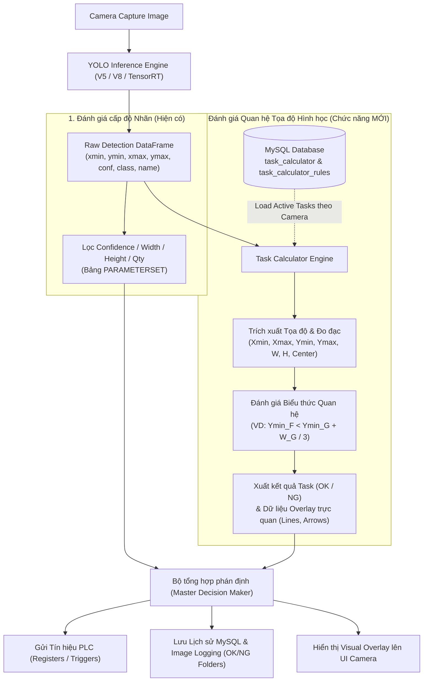

# KẾ HOẠCH & BẢN THIẾT KẾ KIẾN TRÚC: CHỨC NĂNG TASK CALCULATOR (VISION GEOMETRIC INSPECTION)

> **Mục tiêu:** Phát triển module **Task Calculator Workspace** cho từng Camera, cho phép người dùng cấu hình các bài toán kiểm tra ngoại quan nâng cao dựa trên quan hệ hình học, tọa độ tương đối ($X_{\min}, X_{\max}, Y_{\min}, Y_{\max}$), kích thước ($W, H$) và khoảng cách giữa các nhãn AI phát hiện được thông qua giao diện Low-Code / Visual Bounding Box trực quan.

---

## 1. Tổng quan & Luồng Dữ Liệu Toàn Hệ Thống



---

## 2. Chi Tiết Từng Bước Triển Khai (Kèm Khu Vực Review & Góp Ý)

---

### 🟢 BƯỚC 1: Chuẩn hóa Cơ sở Dữ liệu (Database Schema)

#### Vấn đề hiện tại:
Tại file `c:\project_vision\intenal\module_1\table_db.py`, bảng `task_calculator` và `task_calculator_data` đang có lỗi cú pháp `...` (placeholder) và chưa đủ các trường để lưu các phép so sánh quan hệ phức tạp (như offset tỷ lệ $+ \text{Width}(G)/3$, loại toán tử, v.v.).

#### Đề xuất thiết kế bảng chuẩn:
```sql
-- 1. Bảng lưu danh sách Task của từng Camera
CREATE TABLE IF NOT EXISTS task_calculator (
    id                  INT AUTO_INCREMENT PRIMARY KEY,
    camera_id           INT NOT NULL,
    task_name           VARCHAR(255) NOT NULL,
    task_type           VARCHAR(50) NOT NULL DEFAULT 'RELATION_COORDINATE', 
                        -- Các loại: RELATION_COORDINATE, DISTANCE, CUSTOM_EXPRESSION
    logic_mode          VARCHAR(20) NOT NULL DEFAULT 'ALL_PASS', 
                        -- ALL_PASS (tất cả rule đúng thì OK), ANY_PASS
    action_on_fail      VARCHAR(20) NOT NULL DEFAULT 'NG',
    enabled             TINYINT(1) NOT NULL DEFAULT 1,
    created_at          DATETIME NOT NULL DEFAULT CURRENT_TIMESTAMP,
    updated_at          DATETIME NOT NULL DEFAULT CURRENT_TIMESTAMP ON UPDATE CURRENT_TIMESTAMP,
    FOREIGN KEY (camera_id) REFERENCES NUMS_CAMERA(id) ON DELETE CASCADE
) ENGINE=InnoDB DEFAULT CHARSET=utf8mb4;

-- 2. Bảng lưu chi tiết các Rule trong từng Task
CREATE TABLE IF NOT EXISTS task_calculator_rules (
    id                      INT AUTO_INCREMENT PRIMARY KEY,
    task_id                 INT NOT NULL,
    rule_name               VARCHAR(255),
    
    -- Đối tượng 1 (Target Label A)
    label_1                 VARCHAR(255) NOT NULL,
    param_1                 VARCHAR(50) NOT NULL, 
                            -- X_MIN, X_MAX, Y_MIN, Y_MAX, WIDTH, HEIGHT, CENTER_X, CENTER_Y
    instance_select_1       VARCHAR(50) NOT NULL DEFAULT 'BEST_CONF', 
                            -- BEST_CONF, LEFTMOST, RIGHTMOST, TOPMOST, BOTTOMMOST
    
    -- Phép toán so sánh
    operator                VARCHAR(20) NOT NULL, 
                            -- '<', '<=', '>', '>=', '==', '!=', 'BETWEEN'
    
    -- Đối tượng 2 (Reference: Nhãn B hoặc Hằng số)
    target_type             VARCHAR(50) NOT NULL DEFAULT 'LABEL', 
                            -- 'LABEL' hoặc 'CONSTANT'
    label_2                 VARCHAR(255),
    param_2                 VARCHAR(50), 
                            -- X_MIN, X_MAX, Y_MIN, Y_MAX, WIDTH, HEIGHT, CENTER_X, CENTER_Y
    instance_select_2       VARCHAR(50) NOT NULL DEFAULT 'BEST_CONF',
    
    -- Toán tử bù trừ / Tỷ lệ mở rộng (VD: + Width(G) / 3 hoặc + 15.5 pixel)
    math_op                 VARCHAR(10) DEFAULT 'NONE', 
                            -- 'NONE', '+', '-', '*', '/'
    math_operand_type       VARCHAR(50) DEFAULT 'CONSTANT', 
                            -- 'CONSTANT' hoặc 'LABEL_PARAM' (VD: lấy Width của nhãn B)
    math_operand_val        VARCHAR(255) DEFAULT '0', 
                            -- Lưu số hằng số hoặc biểu thức như "Width / 3.0"
    
    -- Khoảng dung sai (dùng cho toán tử BETWEEN hoặc dung sai sai số)
    min_value               DOUBLE DEFAULT 0,
    max_value               DOUBLE DEFAULT 0,
    
    -- Kết luận khi điều kiện THỎA MÃN (Condition is TRUE)
    condition_true_result   VARCHAR(10) NOT NULL DEFAULT 'NG', 
                            -- 'NG' hoặc 'OK' (Ví dụ: nếu Xmin(A) < Xmin(B) là TRUE thì kết luận NG)
    
    enabled                 TINYINT(1) NOT NULL DEFAULT 1,
    description             TEXT,
    FOREIGN KEY (task_id) REFERENCES task_calculator(id) ON DELETE CASCADE
) ENGINE=InnoDB DEFAULT CHARSET=utf8mb4;
```

> 💬 **Góp ý / Đánh giá của bạn cho Bước 1:**
> *(Bạn có thể bổ sung cột nào khác cần lưu trữ ở đây không, ví dụ PLC Register riêng cho từng task nếu có)*
> ...

---

### 🟢 BƯỚC 2: Giao diện Quản lý Task Workspace (`TaskWorkspaceDialog`)

#### Điểm kích hoạt:
Nhấn nút `pushButton_add_tasks` (Tooltip: *"Tasks Resolve"*) tại `module_3/layout_option_model.py:L1421`.

#### Thiết kế Giao diện:
- **Tiêu đề:** `Task Workspace Manager - Camera: [Tên Camera] | Item Code: [Mã hàng]`
- **Bảng danh sách Task (QTableWidget):**
  - Cột 1: `ID`
  - Cột 2: `Tên Task` (VD: *Kiểm tra lệch mép linh kiện A & B*)
  - Cột 3: `Loại Task` (*Tọa độ quan hệ*, *Khoảng cách*, *Biểu thức*)
  - Cột 4: `Số lượng Rule` (VD: *2 rules*)
  - Cột 5: `Đánh giá khi vi phạm` (Badge đỏ: *NG* / Badge xanh: *OK*)
  - Cột 6: `Kích hoạt` (Checkbox có thể bật/tắt trực tiếp)
  - Cột 7: `Thao tác` (Nút *Sửa*, *Xóa*, *Nhân bản*)
- **Thanh công cụ (Toolbar Buttons):**
  - `[+ Thêm Task Mới]`: Mở hộp thoại soạn thảo Task.
  - `[✏️ Chỉnh Sửa Task]`: Mở hộp thoại chỉnh sửa Task được chọn.
  - `[🗑️ Xóa Task]`: Xác nhận và xóa Task cùng các Rule liên quan.
  - `[📋 Sao Chép (Clone)]`: Nhân bản nhanh một Task sang Camera khác hoặc cùng Camera.
  - `[▶️ Test Thử Nghiệm]`: Chạy thử tất cả Task trên khung hình hiện tại của Camera và hiển thị bảng kết quả đánh giá (PASS/FAIL từng rule kèm giá trị đo thực tế).

```text
+---------------------------------------------------------------------------------------------------+
|  TASK WORKSPACE MANAGER - Camera: Camera-01 [LINE_01]                                             |
+---------------------------------------------------------------------------------------------------+
|  [ + Thêm Task mới ]   [ ✏️ Sửa Task ]   [ 🗑️ Xóa ]   [ 📋 Nhân bản ]   [ ▶ Test với ảnh hiện tại ]      |
+----+-----------------------+---------------------+---------+-------------+-----------+------------+
| ID | Tên Task              | Loại Task           | Số Rule | Khi vi phạm | Kích hoạt | Thao tác   |
+----+-----------------------+---------------------+---------+-------------+-----------+------------+
| 1  | Ktra Lệch Nhãn A & B  | RELATION_COORDINATE | 2 Rules |   [ NG ]    |    [✓]    | [Sửa] [Xóa]|
| 2  | Ktra Chiều Cao Nhãn C | RELATION_COORDINATE | 1 Rules |   [ NG ]    |    [✓]    | [Sửa] [Xóa]|
| 3  | Ktra Khoảng Cách F-G  | DISTANCE_CALC       | 1 Rules |   [ NG ]    |    [ ]    | [Sửa] [Xóa]|
+----+-----------------------+---------------------+---------+-------------+-----------+------------+
| Tổng cộng: 3 tasks | Đang kích hoạt: 2 tasks                                  [ Đóng ] [ Áp dụng ]|
+---------------------------------------------------------------------------------------------------+
```

> 💬 **Góp ý / Đánh giá của bạn cho Bước 2:**
> *(Bạn muốn giao diện hiển thị thêm thông tin gì trên bảng Task này không?)*
> ...

---

### 🟢 BƯỚC 3: Giao diện Soạn thảo Luật & Mô hình Đồ họa 2 Nhãn (`TaskRuleEditorDialog`)

Đây là phần hiện thực hóa ý tưởng của bạn: **Low-Code + Visual Graphic Canvas** để người dùng không cần gõ công thức phức tạp mà chỉ cần click vào cạnh tương ứng của 2 hộp nhãn!

#### Cấu trúc Dialog:
1. **Thông tin chung Task:**
   - Tên Task (QLineEdit)
   - Loại Task (QComboBox: So sánh tọa độ, Khoảng cách tâm, Tỷ lệ kích thước)
   - Kết luận tổng: `AND` (Tất cả Rule phải đạt) hoặc `OR` (Một trong các Rule vi phạm)

2. **Khu vực Đồ họa Trực quan (Visual Bounding Box Graphic Canvas):**
   - Vẽ 2 hình chữ nhật tượng trưng cho **Nhãn A (Màu xanh dương)** và **Nhãn B (Màu cam)**.
   - Mỗi hình chữ nhật có các điểm neo (Hotspots) tương tác:
     - Cạnh Trên: $Y_{\min}$
     - Cạnh Dưới: $Y_{\max}$
     - Cạnh Trái: $X_{\min}$
     - Cạnh Phải: $X_{\max}$
     - Tâm: $\text{Center}(X, Y)$
     - Chiều rộng: $\text{Width}$
     - Chiều cao: $\text{Height}$
   - **Tương tác trực quan:**
     - Người dùng click vào **Cạnh Trái** của Nhãn A $\to$ Tự động chọn vế trái là `Xmin(Label A)`.
     - Người dùng click vào **Cạnh Trái** của Nhãn B $\to$ Tự động chọn vế phải là `Xmin(Label B)`.

3. **Thanh dựng công thức (Rule Formula Builder):**
   - Vế trái (LHS): `[ Nhãn A ]` `[ Tham số: Xmin / Ymin / ... ]`
   - Toán tử: `[ < / <= / > / >= / == / != / BETWEEN ]`
   - Vế phải (RHS): `[ Nhãn B ]` `[ Tham số: Xmin / Ymin / ... ]` (hoặc chuyển sang nhập Số cố định)
   - Bổ trợ toán học (Offset / Factor):
     - Dạng cộng/trừ cố định: `+ [ 0.0 ] pixel`
     - Dạng công thức tỷ lệ như ví dụ của bạn: `+ [ Width(B) ] / [ 3 ]`
   - Điều kiện kết luận: `Nếu điều kiện đúng thì:` `[ Đánh giá NG / Đánh giá OK ]`
   - Nút: `[ + Thêm Rule vào Task ]`

```text
+---------------------------------------------------------------------------------------------------+
|  CHỈNH SỬA TASK: Ktra Lệch Nhãn A & B                                                             |
+---------------------------------------------------------------------------------------------------+
| Tên Task: [ Ktra Lệch Nhãn A & B        ]   Loại: [ Tọa độ quan hệ (Relation) ▼ ]                 |
| Đánh giá tổng thể: [ Tất cả Rule phải thỏa mãn (AND) ▼ ]   Kết luận khi vi phạm: [ NG ▼ ]         |
+---------------------------------------------------------------------------------------------------+
| 💡 CHỌN CẠNH / TỌA ĐỘ TRỰC QUAN (Visual Graphic Selector):                                        |
|                                                                                                   |
|       [ Nhãn 1: label_A  ▼ ]                            [ Nhãn 2: label_B  ▼ ]                    |
|       +-------------------+                             +-------------------+                     |
|       |     Top (Ymin)    |                             |     Top (Ymin)    |                     |
|  Left |       [●]         | Right                  Left |       [●]         | Right               |
| (Xmin)| [●] Center    [●] | (Xmax)                (Xmin)| [●] Center    [●] | (Xmax)              |
|  [●]  |                   |  [ ]                   [●]  |                   |  [ ]                |
|       |    Bottom (Ymax)  |                             |    Bottom (Ymax)  |                     |
|       +-------------------+                             +-------------------+                     |
|       (Click vào chấm tròn / cạnh để tự động gán tọa độ)                                          |
+---------------------------------------------------------------------------------------------------+
| 📐 THIẾT LẬP BIỂU THỨC QUY TẮC:                                                                   |
|  Nếu: [ Xmin(label_A)  ▼ ]  [ < (Nhỏ hơn) ▼ ]  [ Xmin(label_B)  ▼ ]  + [ Offset / Biểu thức ]     |
|  Công thức mở rộng (nếu có):  + ( [ Width(label_B) ] / [ 3.0 ] )                                  |
|  ===> Khi điều kiện trên xảy ra thì Kết luận: [ Đánh giá NG ▼ ]                                   |
|                                                                                                   |
|  [ + Lưu Rule vào Task ]   [ 🗑️ Xóa Rule ]                                                        |
+---------------------------------------------------------------------------------------------------+
| Danh sách các Rule thuộc Task này:                                                                |
| 1. Xmin(label_A) < Xmin(label_B) => NG                                                            |
| 2. Ymin(label_F) < Ymin(label_G) + Width(label_G)/3.0 => NG                                       |
+---------------------------------------------------------------------------------------------------+
|                                                                             [ Hủy ]  [ Lưu Task ] |
+---------------------------------------------------------------------------------------------------+
```

> 💬 **Góp ý / Đánh giá của bạn cho Bước 3:**
> *(Mô hình 2 ô nhãn đồ họa và thanh công thức như trên đã thỏa mãn đúng ý tưởng bạn mong muốn chưa?)*
> ...

---

### 🟢 BƯỚC 4: Engine Đánh Giá Hình Học (`TaskCalculatorEngine`)

Tạo module độc lập `module_3/task_calculator_engine.py` để thực hiện tính toán với các tiêu chí kỹ thuật:

#### 1. Chiến lược xử lý Đa nhãn (Multi-Instance Strategy):
Trong thực tế, 1 ảnh có thể có nhiều nhãn A hoặc nhiều nhãn B. Engine hỗ trợ các cơ chế:
- **`BEST_CONF` (Mặc định):** Lấy bounding box có độ tin cậy cao nhất của nhãn đó.
- **`LEFTMOST` / `RIGHTMOST`:** Lấy box nằm ngoài cùng bên trái hoặc bên phải.
- **`ALL_PAIRS`:** Kiểm tra tất cả các cặp có thể có giữa các nhãn A và nhãn B.

#### 2. Cơ chế Safe Evaluator (Đảm bảo an toàn và tốc độ cao):
- Tuyệt đối **không dùng `eval()` nguyên thủy của Python** (tránh nguy cơ injection và chậm).
- Dùng bộ parser phân tích biểu thức số học toán tử:
  $$\text{LHS} = \text{GetParam}(\text{Label}_A, \text{Param}_1)$$
  $$\text{RHS} = \text{GetParam}(\text{Label}_B, \text{Param}_2) \times \text{Factor} + \text{Offset}$$
  So sánh: $\text{Result} = \text{Compare}(\text{LHS}, \text{Operator}, \text{RHS})$

#### 3. Xử lý trường hợp thiếu nhãn (Missing Label Handling):
- Nếu ảnh không nhận diện được nhãn A hoặc nhãn B cần cho phép cấu hình:
  - Lựa chọn 1: Báo lỗi NG ngay lập tức vì thiếu linh kiện.
  - Lựa chọn 2: Bỏ qua (SKIP) nếu task đó là tùy chọn.

#### 4. Dữ liệu Visual Overlay:
- Trả về danh sách các điểm, mũi tên và text đo khoảng cách để vẽ trực tiếp lên ảnh hiển thị (viền đỏ nếu vi phạm, viền xanh nếu hợp lệ), giúp kỹ sư và người vận hành nhìn thấy ngay sai lệch ở đâu trên màn hình.

> 💬 **Góp ý / Đánh giá của bạn cho Bước 4:**
> *(Về mặt thuật toán, bạn có cần bổ sung phép toán nào khác không, ví dụ góc nghiêng Angle, diện tích Area, hoặc khoảng cách Euclidean $\sqrt{\Delta x^2 + \Delta y^2}$?)*
> ...

---

### 🟢 BƯỚC 5: Tích hợp Pipeline & Điều Khiển PLC

#### Vị trí tích hợp:
- Gọi `TaskCalculatorEngine` ngay sau khi hàm `run_model()` trong `_source/v5/v5.py` hoặc `_source/v8/v8.py` hoàn thành inference.
- Kết hợp cờ kết quả của Task Calculator vào biến cờ phán định `flag` tổng:
  $$\text{Final Flag} = \text{Label Flag (Hiện tại)} \land \text{Task Calculator Flag}$$
- Nếu có cấu hình thanh ghi PLC riêng cho Task lỗi, gửi giá trị tương ứng vào thanh ghi PLC để máy gắp/đẩy phế phẩm hoạt động.

> 💬 **Góp ý / Đánh giá của bạn cho Bước 5:**
> *(Bạn có cần gán Register PLC riêng cho từng Task không, hay chỉ cần dùng chung cờ NG tổng hiện tại?)*
> ...

---

## 3. Lộ Trình Triển Khai Đề Xuất (Action Checklist)

- [ ] **Giai đoạn 1: Chuẩn hóa Database**
  - Sửa lỗi cú pháp tại `module_1/table_db.py`.
  - Thêm bảng `task_calculator` và `task_calculator_rules`.
- [ ] **Giai đoạn 2: Xây dựng UI Task Workspace**
  - Thiết kế dialog `TaskWorkspaceDialog` hiển thị danh sách task của camera hiện tại.
  - Kết nối sự kiện `clicked` của nút `self.pushButton_add_tasks` trong `layout_option_model.py`.
- [ ] **Giai đoạn 3: Xây dựng UI Rule Editor & Visual Graphic Canvas**
  - Tạo widget vẽ 2 hộp nhãn Bounding Box với các điểm neo (hotspots) để người dùng click chọn cạnh.
  - Xây dựng thanh công cụ tạo công thức so sánh.
- [ ] **Giai đoạn 4: Viết Engine Tính toán Hình học**
  - Viết module `TaskCalculatorEngine` có test kiểm thử độc lập (Unit Test) cho mọi trường hợp so sánh.
- [ ] **Giai đoạn 5: Tích hợp Runtime & Hiển thị Trực quan**
  - Ghép engine vào luồng kiểm tra chính của camera.
  - Vẽ overlay các đường đo và thông báo kết quả trực tiếp lên khung hình camera.
